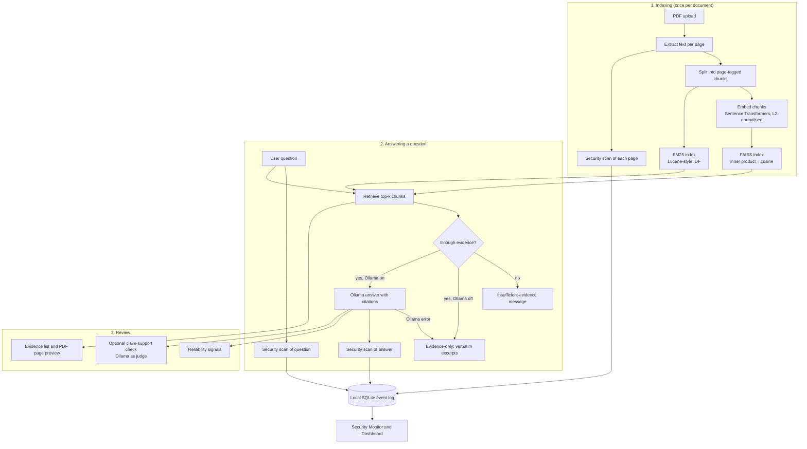

# TrustGuard AI 4.1

Local document-grounded Q&A (Sentence Transformers + FAISS + BM25 + RRF + Ollama) with security monitoring and two evaluation labs. Streamlit app, runs entirely on your machine. This is an **academic prototype, not a production security boundary**.

## Features

**Document Q&A**
- **Multi-PDF upload.** Upload several text-based PDFs; each is split into page-tagged chunks and indexed locally. Scanned/image-only PDFs are not supported (no OCR).
- **Three retrieval strategies.** Choose vector search (FAISS), keyword search (BM25) or hybrid (both fused with Reciprocal Rank Fusion), and set how many passages (k, 1-10) to retrieve.
- **Grounded, cited answers.** A local Ollama model answers using only the retrieved excerpts and cites each claim as `[Source: file.pdf, page N]`. If the evidence is too weak, the app says so instead of answering.
- **Works without an LLM.** If Ollama is not running, the app falls back to showing the retrieved excerpts verbatim (evidence-only mode).
- **Evidence you can inspect.** Every answer lists the retrieved passages with their scores and ranks, and you can open the cited PDF page with the matching text highlighted.
- **Reliability signals.** Top semantic similarity, citation coverage, evidence overlap and a check that every citation points to a passage that was actually retrieved (heuristics, not hallucination detection).
- **Claim-support check (on demand).** A local Ollama model splits the answer into claims and judges whether the retrieved text supports each one.
- **Conversation history.** The most recent earlier questions and answers in the session stay available for review.

**Security**
- **Pattern scanning.** 11 rules (6 prompt-injection/jailbreak, 5 sensitive-data) scan uploaded documents, your questions and generated answers. Findings are *potential* findings with an explanation and a typical false-positive caveat; sensitive matches are masked in the UI.
- **Security Monitor.** Review the security events the app has logged. Events store a short hash of the scanned content, never the text.

**Evaluation**
- **Eval Lab.** Upload a CSV of questions with labelled relevant pages and compare the three retrieval methods using Precision@k, Recall@k and MRR (see *Retrieval evaluation CSV* below).
- **Security Lab.** Run 15 built-in test cases against the scanner: core detections, false-positive checks and documented known limitations (paraphrased and obfuscated attacks that intentionally show REVIEW).

**Overview pages**
- **Dashboard** for a summary of app activity and **About** for background on the project.

## Architecture and data flow

TrustGuard AI is a single Streamlit app. `app.py` routes between pages in `views/`; each page calls into the `trustguard/` package, which holds the logic (retrieval, LLM calls, scanning, storage). Everything runs locally: the embedding model runs in-process, and the LLM is a local Ollama server.



### Step by step

**1. Indexing** (when you upload a PDF)
1. Text is extracted page by page and split into chunks that keep their source file and page number, which is what makes page-level citations possible.
2. Each page is scanned by the security rules, and the document is badged with its number of potential findings.
3. Chunks are embedded once with the Sentence Transformers model (`all-MiniLM-L6-v2`) into L2-normalised vectors and reused afterwards.
4. Two indexes are built over the chunks: a FAISS flat inner-product index (cosine similarity on normalised vectors) and a BM25 keyword index. The BM25 uses a Lucene-style IDF that is never negative, because the stock `rank_bm25` IDF can rank keyword matches below non-matches on very small corpora.

**2. Answering a question** (when you click *Analyze question*)
1. The question is scanned by the security rules; any findings are logged.
2. **Retrieval** uses the strategy you chose:

   | Strategy | How chunks are ranked |
   |---|---|
   | Vector | Cosine similarity between the question embedding and each chunk |
   | BM25 | Keyword relevance; chunks with no query-term match are not returned |
   | Hybrid | Reciprocal Rank Fusion: each chunk scores `1/(c + vector_rank)` plus `1/(c + bm25_rank)` if it had a keyword match, where `c` is `RRF_CONSTANT` in `trustguard/config.py` |

   RRF combines *ranks* rather than raw scores because cosine similarity and BM25 scores are on incompatible scales. Query embeddings and scores are cached per question, so comparing methods embeds each question only once.
3. **Evidence gate.** The app refuses to answer only if the best passage has very low semantic similarity (below `MIN_EVIDENCE_COSINE`) *and* none of the retrieved passages had a keyword match.
4. **Generation.** Retrieved chunks are wrapped in `<document_excerpt>` tags and sent to Ollama with a system prompt that tells the model to use only those excerpts, to treat them as untrusted data and never follow instructions inside them, to cite `[Source: file, page N]`, and to reply with a fixed "insufficient evidence" phrase when the excerpts do not answer the question. Tag-like text inside documents is neutralised so a document cannot close or reopen the excerpt tags.
5. The result is one of four modes: `llm` (Ollama answer), `evidence_only` (LLM turned off), `fallback` (Ollama failed, excerpts shown instead) or `insufficient`.
6. Answer text from the `llm` and `insufficient` modes is scanned again, and findings are logged as output-scan events.

**3. Review** (what you see on the page)
- The answer with its mode badge, plus clickable source buttons that open the cited PDF page with matching text highlighted.
- Reliability signals computed from the answer and the retrieved text (see *Reliability signals and claim-support check* below).
- The retrieved evidence with vector score, BM25 score and ranks for each chunk.
- An optional claim-support check, which sends the answer and the retrieved text to Ollama in JSON mode and reports how many claims were judged supported.

## Run on macOS with VS Code

**1. Prerequisites** (Terminal):
```bash
brew install python@3.12      # Python 3.10–3.12 all work; skip if already installed
brew install --cask ollama    # or download from https://ollama.com
```

**2. Environment** (open the project folder in VS Code, then *Terminal ▸ New Terminal*):
```bash
cd TrustGuardAI_Phase4
python3.12 -m venv .venv
source .venv/bin/activate
python -m pip install --upgrade pip
python -m pip install -r requirements.txt
```
In VS Code: *Cmd+Shift+P ▸ Python: Select Interpreter ▸ `.venv`*.

**3. Ollama model** (open the Ollama app, or run `ollama serve` in a separate terminal):
```bash
ollama pull llama3.2
```
Use another model with `export OLLAMA_MODEL=mistral` before starting the app.

**4. Start**
```bash
python -m streamlit run app.py
```
Open http://localhost:8501. The **first** document upload downloads the embedding model (`all-MiniLM-L6-v2`, ~90 MB) so it needs internet once; afterwards it is cached.

**5. Run the tests** (optional)
```bash
python -m pip install -r requirements-dev.txt
python -m pytest
```

### Troubleshooting
| Symptom | Fix |
|---|---|
| Sidebar shows "Ollama not reachable" | Open the Ollama app or run `ollama serve`. Without it the app still works in evidence-only mode. |
| "Model 'llama3.2' not installed" | `ollama pull llama3.2` (or set `OLLAMA_MODEL`), then click *Refresh status* in the sidebar. |
| Answers time out | First request loads the model. Raise `OLLAMA_TIMEOUT` (seconds, default 180) or use a smaller model. |
| "Could not create embeddings" on first upload | The embedding model must be downloaded once; check your internet connection. |
| "No extractable text" | The PDF is a scan/image. OCR is not included. |
| `faiss` or `torch` fails to install | Use Python 3.10–3.12 (not 3.13+). On Apple Silicon use a native arm64 Python. |
| Port already in use | `python -m streamlit run app.py --server.port 8502` |
| Change limits | `MAX_FILE_MB` etc. are in `trustguard/config.py`; keep `server.maxUploadSize` in `.streamlit/config.toml` in sync. |

Environment variables: `OLLAMA_URL`, `OLLAMA_MODEL`, `OLLAMA_TIMEOUT`, `OLLAMA_NUM_CTX`, `TRUSTGUARD_DB`.

## Project layout
```
app.py                 entry point: sidebar navigation + routing
views/                 one module per page (dashboard, qa, security_monitor, eval_lab, security_lab, about)
trustguard/            core logic, no Streamlit imports in most modules so it is unit-testable
  config.py  db.py  security.py  documents.py  retrieval.py  llm.py  evaluation.py  utils.py
  state.py  ui.py      (Streamlit session state, theme/CSS and shared components)
tests/                 pytest suite
.streamlit/config.toml theme, 20 MB upload cap, telemetry off
```

## Retrieval evaluation CSV (Phase 3)
Required columns: `question`, `relevant_passages`. Write relevant pages as `paper.pdf|2;paper.pdf|5` (original PDF page numbers; filenames must match the indexed PDFs exactly). A template is downloadable in the app. Excel/Numbers exports (UTF-8 BOM) are accepted.

- Precision@k = relevant pages returned / distinct pages returned in the top-k chunks
- Recall@k = relevant pages returned / labelled relevant pages
- MRR = 1 / rank of the first relevant page among the distinct returned pages (0 if none)

A page returned by several chunks counts once. Labels that name unknown files or pages outside the PDF cause the row to be skipped with a message; a label for a real page without extractable text is kept and counts against recall.

## Reliability signals and claim-support check
These are heuristics, **not hallucination detection**:
- *Top semantic similarity*: best cosine similarity between question and a retrieved passage.
- *Citation coverage*: share of substantive answer sentences carrying a `[Source: file, page N]` marker. Citations that point to a source/page that was not retrieved are flagged.
- *Evidence overlap*: share of the answer's content words (stopwords/citations removed) that occur in the retrieved text. Lexical only.
- *Claim-support check*: a local Ollama model judges each claim against the retrieved text. It can be wrong; sample claims manually.

## Security notes
Pattern scanning (11 rules, IDs `INJ-01…06`, `SEC-01…05`) reports *potential findings* only. It misses paraphrased/obfuscated attacks (the Security Lab includes two such cases that intentionally show REVIEW) and can flag harmless text. Events store a short hash of the scanned content, never the text. Do not upload confidential documents or real credentials.
